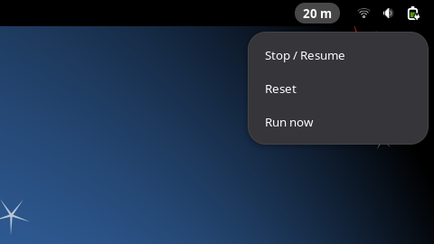
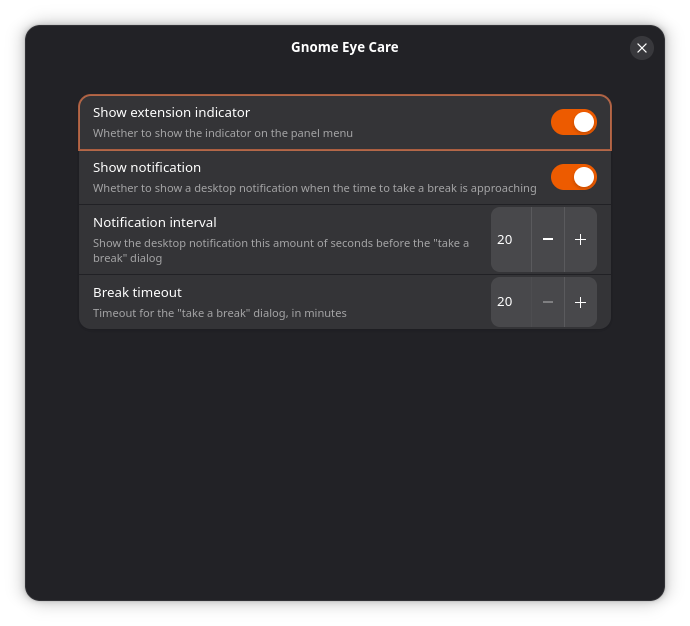
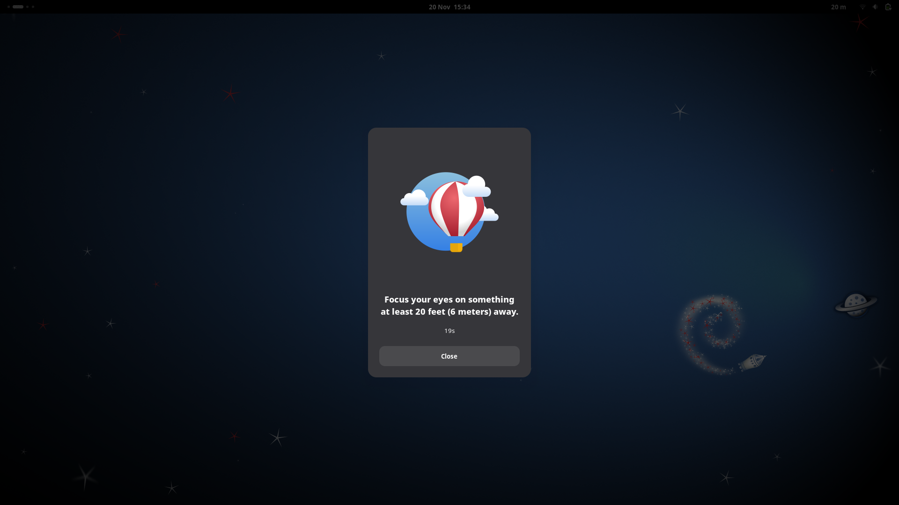

# Gnome Eye Care

Gnome Eye Care is a Gnome extension that helps you to follow the [20-20-20 rule](https://opto.ca/health-library/the-20-20-20-rule) by remind you to take the breaks each 20 minutes.

## Installation
```console
$ sudo apt install libnotify4 gir1.2-gsound-1.0
$ git clone https://github.com/gnumoksha/gnome-eye-care ~/.local/share/gnome-shell/extensions/gnome-eye-care@gnumoksha.github.io
$ gnome-extensions enable gnome-eye-care@gnumoksha.github.io
```

## Screenshots




